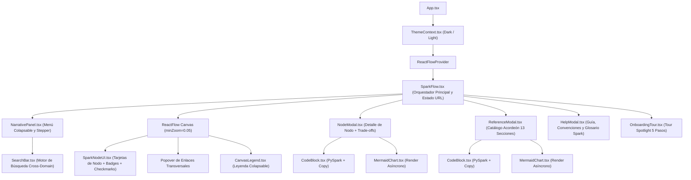
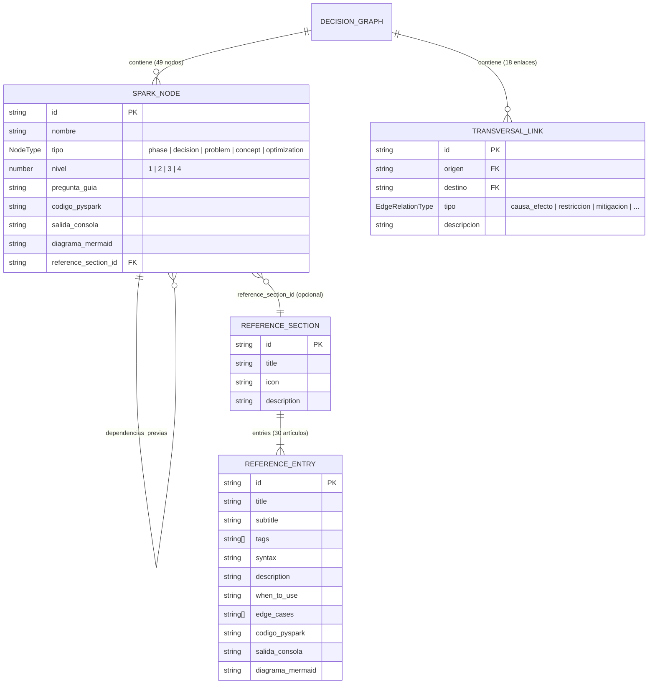
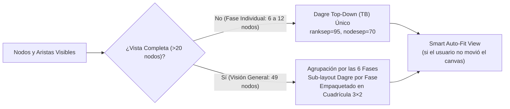
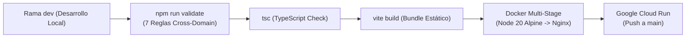

# 🏗️ Arquitectura Técnica (`docs/ARCHITECTURE.md`)

Este documento describe la arquitectura interna de **Spark Pipeline Architecture & Encyclopedia**, incluyendo la jerarquía de componentes React, el modelo de datos cruzado (Grafo + Enciclopedia), el motor de posicionamiento automático (`Dagre` + `React Flow`) y el pipeline de validación e integración continua.

---

## 1. Visión General del Sistema y Árbol de Componentes

La aplicación es una **Single Page Application (SPA)** construida con **React 19**, **TypeScript 6**, **Vite 8**, **React Flow (`@xyflow/react`)**, **Dagre** y **Mermaid.js**.

---

## 2. Modelo de Datos y Vinculación Cross-Domain

El conocimiento técnico se divide en dos datasets JSON fuertemente tipados en [`src/models/types.ts`](../src/models/types.ts) y validados estáticamente por [`scripts/parser.ts`](../scripts/parser.ts):

### Relación entre Dominios
- **Aristas Jerárquicas (`parent -> child`):** Generadas a partir de `node.subdecisiones`. Se dibujan como líneas continuas y definen la estructura del árbol dentro de cada fase.
- **Aristas Transversales (`enlaces_transversales`):** Conectan nodos dentro de una misma fase o entre fases distantes (por ejemplo, `data_skew` en Fase 2 hacia `estrategia_fisica_join` en Fase 3 y `capacidades_aqe` en Fase 5). Se dibujan como líneas punteadas coloreadas según su `EdgeRelationType` y siempre se listan en la sección **🔗 Cross-Phase Trade-offs & Relations** dentro de `NodeModal.tsx`.
- **Puente a la Enciclopedia (`reference_section_id`):** Permite que cualquier nodo del grafo abra directamente su sección correspondiente en `ReferenceModal.tsx`.

---

## 3. Motor de Layout Dinámico y Auto-Fit View (`src/core/layoutHelper.ts`)

El motor de posicionamiento adapta su algoritmo según la cantidad de nodos visibles:

1. **Modo Fase Individual (`<= 20` nodos):**
   - Ejecuta un único grafo dirigido `dagre` en orientación `TB` (*Top-to-Bottom*) con `nodesep: 70` y `ranksep: 95`.
2. **Modo Visión General (`> 20` nodos — los 49 nodos):**
   - Si los 49 nodos se procesaran en un único árbol plano, los 6 nodos raíz (`nivel === 1`) generarían una fila horizontal extremadamente ancha imposible de leer al hacer zoom out.
   - Para evitarlo, `layoutHelper.ts` particiona los 49 nodos en **6 sub-grafos independientes** (uno por fase arquitectónica), calcula el layout `dagre` interno de cada fase y organiza los 6 bloques resultantes en una **cuadrícula equilibrada de 3 columnas × 2 filas** con relación de aspecto panorámica (~16:10), acompañada de `minZoom={0.05}` en `<ReactFlow>`.
3. **Smart Auto-Fit View (`SparkFlow.tsx`):**
   - Cada vez que el usuario cambia de fase, activa/desactiva *Full Map* o colapsa/expande el panel lateral, el lienzo ejecuta automáticamente `fitView()` tras el renderizado.
   - Si el usuario arrastra el lienzo (`onMoveStart` con evento de usuario) o hace zoom manual dentro de la vista actual, se marca `userMovedCanvasRef.current = true` para respetar su encuadre hasta el próximo cambio de fase o vista.

---

## 4. Sincronización de Estado, Persistencia y URL

| Estado | Mecanismo de Persistencia | Clave / Parámetro |
| :--- | :--- | :--- |
| **Fase activa (`currentStep`)** | URL Query + `localStorage` | `?phase=<stepId>` / `spark_last_phase` |
| **Modo Mapa Completo (`showAllNodes`)** | URL Query | `?view=full` |
| **Nodo abierto (`selectedNodeId`)** | URL Query | `?node=<nodeId>` |
| **Enciclopedia (`activeRefSectionId`, `activeRefEntryId`)** | URL Query | `?ref=<sectionId>&entry=<entryId>` |
| **Tema visual (`dark` / `light`)** | `localStorage` + atributo `<html data-theme>` | `spark_theme` |
| **Nodos visitados (`visitedNodeIds`)** | `localStorage` | `spark_visited_nodes` |
| **Tour de bienvenida completado** | `localStorage` | `spark_onboarding_completed` |

---

## 5. Pipeline de Validación y Despliegue (CI/CD)

- `npm run build` ejecuta en cadena `npm run validate && tsc && vite build`. Si existe cualquier referencia rota en los JSON o un error de tipos en TypeScript, el build se aborta inmediatamente tanto en local como dentro de Docker y GitHub Actions.
